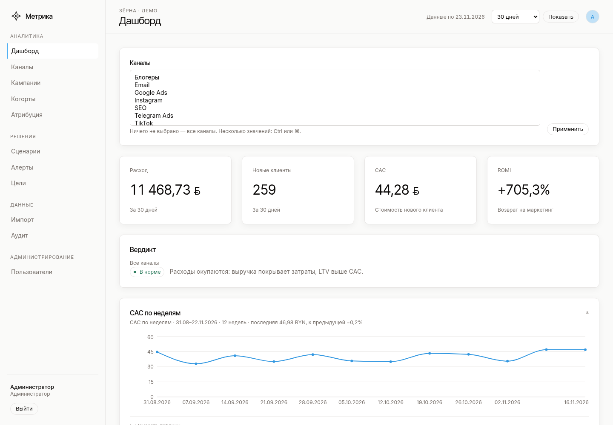

# Метрика

Аналитика эффективности маркетинговых каналов: CAC, когортный LTV, ROMI, атрибуция, алерты и сценарии бюджета.
Приложение помогает ответить на три вопроса: сколько стоит привлечь клиента, сколько он приносит и куда
переложить бюджет, чтобы стало лучше.

Демонстрационные данные — вымышленный интернет-магазин кофе «Зёрна» (Минск), 14 месяцев, все суммы в BYN.
Интерфейс на русском, код и схема БД — на английском.



## Возможности

**Аналитика**

- CAC по каналу, кампании и blended; когортный LTV на 3/6/12 месяцев; ROMI, payback и LTV:CAC со статусом
  здоровья канала.
- Сравнение моделей атрибуции: last-touch, first-touch и linear. Окно атрибуции — 30 дней, распределение
  копеечно-точное.
- Рейтинг каналов с настраиваемыми весами и объяснением вклада каждого критерия.
- Дашборд: KPI, вердикт, недельные CAC/ROMI, расход и выручка, scatter CAC × LTV, фильтр по каналам.
- Карточка канала: метрики, воронка, удержание, кампании и плановые значения.
- Когорты: heatmap удержания и кривая накопленного LTV.
- Цели: план, факт и отклонение по метрике и периоду.

**Данные и решения**

- Каналы и кампании с защитой исторических данных; архивный канал нельзя вернуть в активную кампанию.
- Импорт CSV четырёх типов (`daily_stats`, `customers`, `touchpoints`, `orders`): dry-run, лимиты, отчёт по
  строкам, атомарный откат при ошибках свыше 10%.
- Экспорт CSV с BOM, фильтрами текущего экрана и защитой от formula injection.
- Алерты по четырём полным неделям: CAC, ROMI, payback и LTV:CAC, дедупликация, закрытие с причиной и аудитом.
- Сценарии недельного бюджета: кривые насыщения, KKT-оптимизация, сравнение «сейчас / план», сохранение снимка.
- Изображения хранятся в PostgreSQL и отдаются с `ETag`, `304` и версионированным URL.
- Пользователи и роли, одноразовый сброс пароля, отзыв сессий, журнал аудита.

**Эксплуатация**

- Серверные сессии, argon2id, CSRF, rate-limit, RBAC на каждом маршруте.
- CSP и security-заголовки, `noindex` для приложения, отдельные лимиты для входа и импорта.
- Шифрованные резервные копии `pg_dump` + AES-256-GCM и проверяемое восстановление.
- Docker-стенд с PostgreSQL, healthcheck и автоматическим сидом пустой базы.
- Один stylesheet, локальные шрифты, без CDN.

## Стек

| Слой | Технологии |
|---|---|
| Сервер | Node.js 24 LTS, Express 5, EJS, ES modules |
| Клиент | React 19 (острова), Vite 7, Recharts |
| База данных | PostgreSQL 18, SQL-миграции |
| Авторизация | `express-session`, `connect-pg-simple`, argon2id |
| Валидация | Zod |
| Наблюдаемость | pino, структурные логи, `/health` |
| Тесты | Vitest, Supertest, agent-browser |

## Архитектура

```
routes → controllers → services → repositories → PostgreSQL
                           ↓
                    EJS + React islands
```

- Контроллеры разбирают HTTP и выбирают представление; бизнес-логика — в сервисах, SQL — в репозиториях.
- Каждая страница — серверный EJS-каркас и один React-остров. Начальные данные приходят через `data-props`;
  тот же объект возвращает `/api/v1/*`, поэтому страница и JSON не расходятся.
- Деньги — целые копейки (`BIGINT`), `null` означает «нет данных», а не ноль.
- Даты и когорты считаются в Europe/Minsk; отчётная дата — последняя дата с данными.

## Быстрый старт: Docker

```bash
docker compose up --build
```

Откройте `http://localhost:3000`. Compose поднимает PostgreSQL, применяет миграции и заполняет пустую базу
демо-данными. Порт базы наружу не публикуется. `.env` для запуска не обязателен.

Остановка:

```bash
docker compose down
```

Полный сброс с данными:

```bash
docker compose down -v
```

Перед `down -v` скопируйте ключ резервных копий, если он нужен для старых архивов:
`docker compose cp app:/app/data/backup.key ./backup.key.offline`.

## Локальный запуск

Требования: Node.js 24+, PostgreSQL 18, npm.

```bash
cp .env.example .env
# укажите DATABASE_URL, TEST_DATABASE_URL, ADMIN_DATABASE_URL и SESSION_SECRET
npm ci
npm run db:setup
npm run migrate
npm run seed
npm run build
npm start
```

Откройте `http://localhost:3000`. Для разработки: `npm run dev` (сборка клиента и запуск с `--watch`) и
`npm run build:watch` в отдельном терминале при правках островов.

## Демо-доступы

| Роль | Email | Права |
|---|---|---|
| Администратор | `admin@metrika.by` | пользователи, аудит, все настройки |
| Аналитик | `analyst@metrika.by` | каналы, кампании, цели, импорт, алерты, сценарии |
| Наблюдатель | `viewer@metrika.by` | просмотр и экспорт |

Пароль для всех трёх аккаунтов: `Metrika2026!`.

Это демонстрационный стенд. Перед публичным развёртыванием смените пароли и `SESSION_SECRET`, включите
`COOKIE_SECURE=true` и TLS.

## Скрипты

| Команда | Назначение |
|---|---|
| `npm run dev` | сборка клиента и запуск сервера с наблюдением |
| `npm start` | production-запуск |
| `npm run build` | сборка React-островов и манифеста |
| `npm run db:setup` | создание dev/test баз из `.env` |
| `npm run migrate` | применение SQL-миграций |
| `npm run seed` | детерминированный демо-сид |
| `npm test` | полный набор тестов |
| `npm run backup` | шифрованный бэкап PostgreSQL |
| `npm run restore` | восстановление из бэкапа |
| `npm run check:fresh` | проверка чистого клона: установка, БД, сборка, запуск |

`npm run seed` очищает рабочие таблицы, включая пользователей, сессии, аудит, алерты, сценарии, импорты и медиа.
Не запускайте его на базе с реальными данными.

## Структура

```
src/
  config/        env, пороги метрик, права
  controllers/   страницы и API
  services/      бизнес-логика и расчёты
  repositories/  SQL
  middleware/    auth, CSRF, rate-limit, ошибки
  views/         EJS
  lib/           деньги, даты, форматирование, SEO
db/
  migrations/    схема и индексы
  seed/          демо-данные
client/
  entries/       React-острова
  components/    UI и графики
public/
  css/app.css    единственный stylesheet
  fonts/         Inter, Inter Tight, знак BYN
tests/           unit, integration
scripts/         backup, restore, fresh-clone
docs/            руководства, аудит, производительность
```

## Документация

- [Установка и развёртывание](docs/deployment.md): Docker, Linux, Windows 10, TLS, резервное копирование.
- [Руководство пользователя](docs/user-guide.md): роли и экраны.
- [Аудит безопасности](docs/security-audit.md): маршруты, RBAC, CSRF, заголовки, ограничения.
- [Производительность](docs/performance.md): планы запросов, индексы, бюджеты.
- [Публикация](docs/publication.md): описание репозитория, темы, чек-лист тега.

## Ограничения

- Данные демонстрационные; интеграций с рекламными API нет, только CSV.
- Фильтр по кампаниям на дашборде и сценарное измерение кампаний не реализованы.
- Сценарии общие для всех пользователей; редактирование и удаление сохранённых сценариев не предусмотрены.
- Публичный HTTPS-стенд, Firefox и Windows 10 проверяются владельцем отдельно.

## Лицензия

В корне лежит `LICENSE`-плейсхолдер. До выбора лицензии права не предоставлены. Замените файл на MIT или
проприетарный текст перед публикацией.
