# Руководство пользователя «Метрики»

«Метрика» показывает, куда уходят деньги на привлечение: считает CAC, когортный LTV, ROMI, payback и LTV:CAC по
каналам, сравнивает модели атрибуции, следит за отклонениями и помогает переложить недельный бюджет.

Это демонстрационный стенд. Компания «Зёрна», её каналы, клиенты, заказы и суммы вымышлены и сгенерированы
детерминированно. Все деньги — в белорусских рублях (BYN), расчётные даты — Europe/Minsk. «Сегодня» для расчётов
берётся из данных: это последний день статистики, а не системные часы. В шапке он подписан «Данные по …».

## 1. Вход и роли

Откройте `/login` и введите демо-учётную запись. На странице входа показывается только форма; список аккаунтов и
пароль перечислены в этом руководстве и README.

| Email | Роль | Пароль |
|---|---|---|
| `admin@metrika.by` | Администратор | `Metrika2026!` |
| `analyst@metrika.by` | Аналитик | `Metrika2026!` |
| `viewer@metrika.by` | Наблюдатель | `Metrika2026!` |

Пароль опубликован только для демонстрации. На реальном стенде его меняют до первого входа.

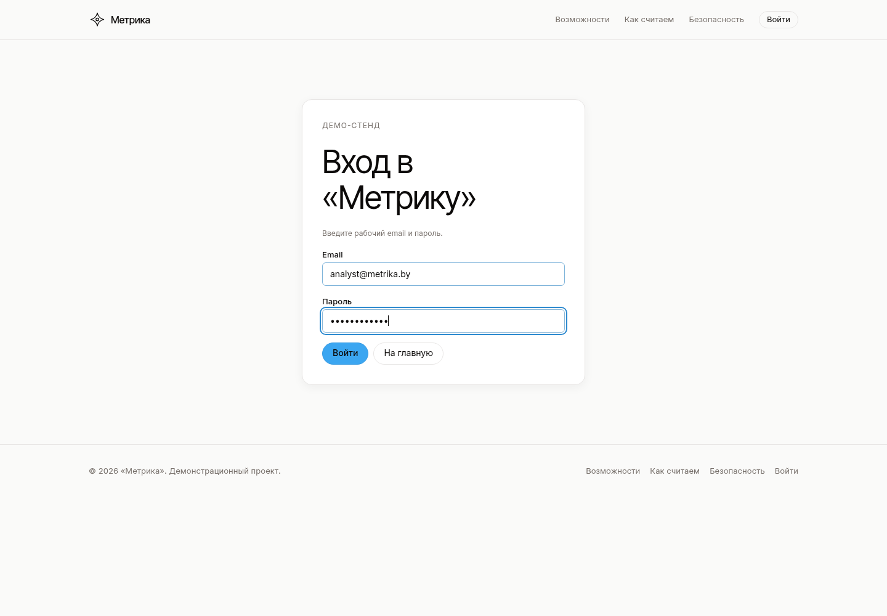

### Что может каждая роль

| Действие | Наблюдатель | Аналитик | Администратор |
|---|---|---|---|
| Смотреть дашборд, каналы, паспорт, кампании, когорты, атрибуцию, алерты, сценарии, цели | да | да | да |
| Экспортировать CSV | да | да | да |
| Создавать и менять каналы, кампании, цели | нет | да | да |
| Пересчитывать и скрывать алерты, сохранять сценарии | нет | да | да |
| Импортировать CSV | нет | да | да |
| Смотреть журнал аудита | нет | нет | да |
| Управлять пользователями и OG-обложкой | нет | нет | да |

Роль проверяется на сервере. Если кнопки нет в интерфейсе, прямой запрос всё равно получит `403`: скрытие кнопки
не является защитой. Наблюдатель видит те же цифры, что и остальные, но не меняет данные.

### Навигация

Слева — разделы по правам роли: «Аналитика», «Решения», «Данные», «Администрирование». Сверху — название компании,
data anchor, выбор периода и кнопка «Показать». Внизу сайдбара — имя, роль, ссылка на профиль и «Выйти».

Сессия живёт 8 часов и хранится в PostgreSQL. Смена роли, блокировка и сброс пароля завершают активные сессии
аккаунта: старая вкладка перестаёт работать, даже если её не закрывали.

## 2. Как читать интерфейс

- **Период** — «30 дней», «90 дней», «180 дней» или явный диапазон в адресе. Период и фильтры живут в URL, поэтому
  ссылку на расчёт можно сохранить и отправить коллеге.
- **Data anchor** — последняя дата, за которую есть статистика. Все окна, когорты и алерты считаются от неё, а не
  от сегодняшнего числа на компьютере.
- **Деньги** — `1 234,56 BYN`, всегда через знак белорусского рубля. Внутри базы суммы хранятся в целых копейках,
  поэтому округление не «плывёт» между экранами.
- **Проценты** — со знаком: `+12,4%`, `−8,1%` (типографский минус). `—` означает «нет данных», а не ноль.
- **Графики** — у каждого есть заголовок-вывод, период, единицы и раскрываемая таблица тех же данных. Таблица нужна
  для скринридера и для точных значений; цифры в ней совпадают с линией.
- **Состояния** — загрузка показывается skeleton-блоками, пустой экран объясняет причину и предлагает действие,
  ошибка — что случилось и кнопку повтора. Если данные неполные, рядом стоит явная пометка.

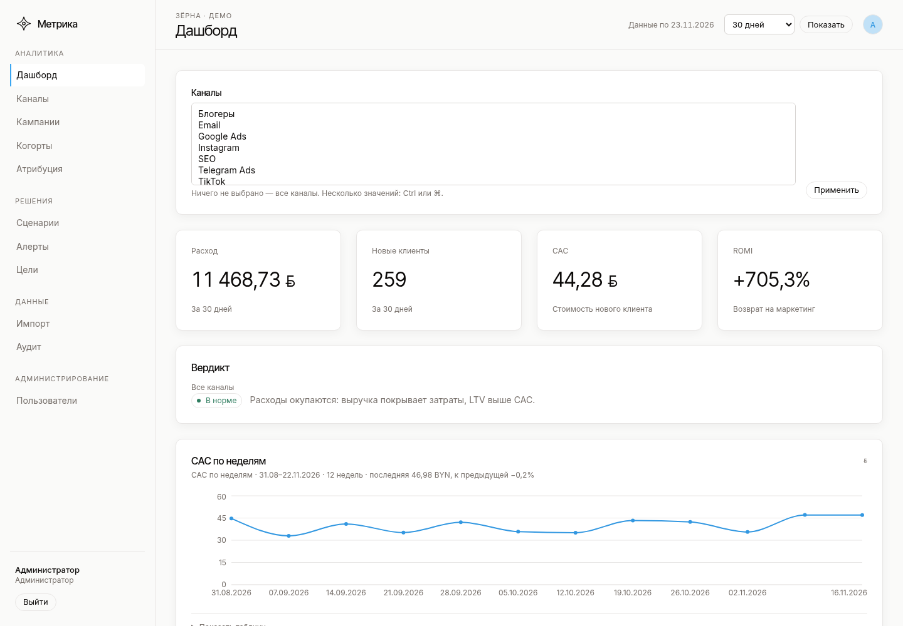

## 3. Экран за экраном

### 3.1. Дашборд

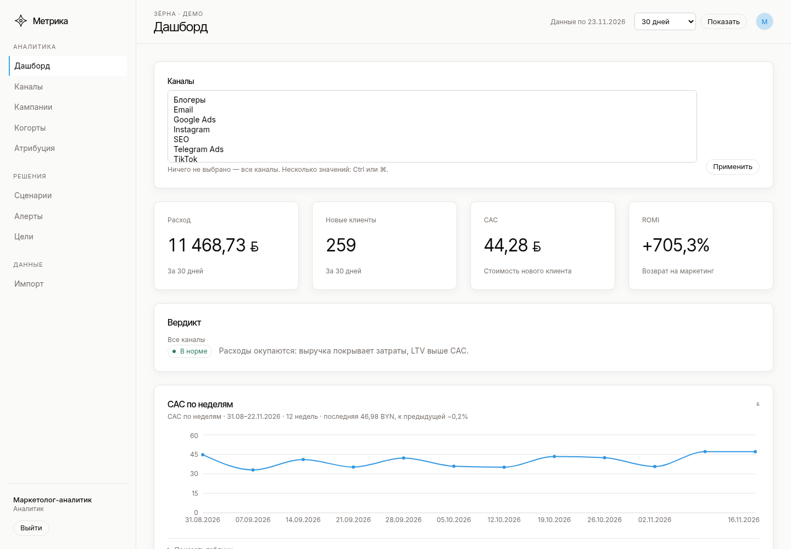

**Что здесь можно понять.** Четыре KPI за период: расход, новые клиенты, CAC и ROMI. Ниже — короткий вердикт:
окупаются ли расходы, есть ли канал, который тянет вниз, хватает ли истории. Недельные графики CAC и ROMI
показывают направление, «Расход и выручка» — баланс денег, «Расход по каналам» — концентрацию бюджета, а
диаграмма CAC×LTV — какие каналы дешевле привлекают и больше приносят.

**Что можно сделать.** Выбрать период, отметить один или несколько каналов (Ctrl или ⌘) и нажать «Применить».
Это GET-фильтры: они не меняют данные и доступны всем ролям.

**Что важно.** Вердикт — не приговор, а подсказка: он опирается на выбранный период и доступные измерения. Если у
канала нет полной истории, его CAC, ROMI и место в рейтинге могут быть `—`.

### 3.2. Каналы

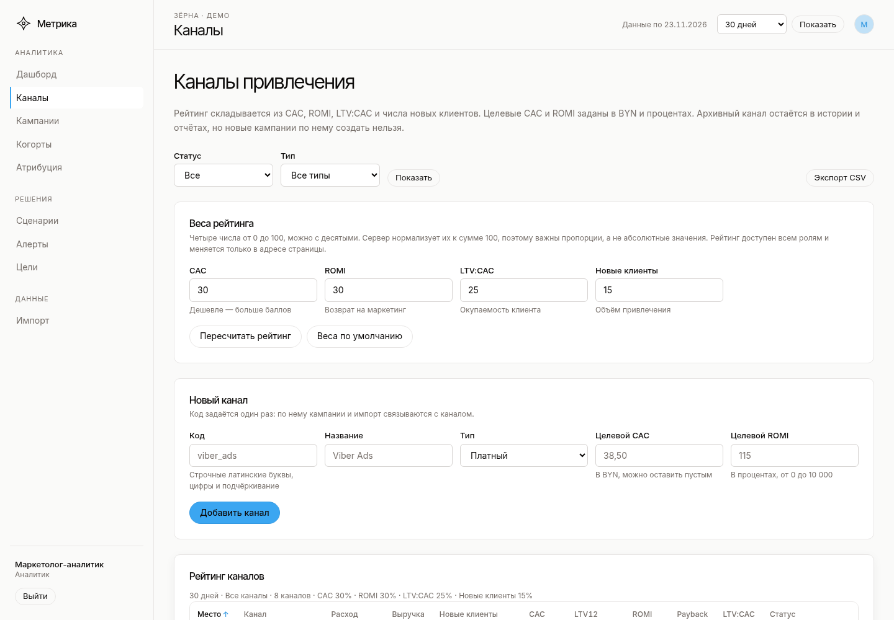

**Что здесь можно понять.** Рейтинг каналов по четырём критериям: CAC, ROMI, LTV:CAC и число новых клиентов.
Веса задаются числами от 0 до 100, сервер нормализует их к сумме 100 — важны пропорции, а не абсолютные значения.
В таблице видны расход, выручка, CAC, LTV12, ROMI, payback, LTV:CAC и статус здоровья; спарклайн показывает
динамику CAC по неделям.

**Что можно сделать.** Отфильтровать по статусу (активные/в архиве) и типу (платные, собственные, заработанные),
изменить веса и пересчитать рейтинг, скачать CSV по текущим фильтрам. Аналитик и администратор могут создать
канал и архивировать его; наблюдатель только смотрит.

**Что важно.** Код канала задаётся один раз: по нему импорт и кампании связываются с каналом. Архивный канал
остаётся в истории и отчётах, но новые кампании по нему создать нельзя. Канал с активными кампаниями архивировать
нельзя — сначала завершите или уберите кампании. «Мало данных» и `—` означают нехватку измерений, а не нулевой
результат.

### 3.3. Паспорт канала

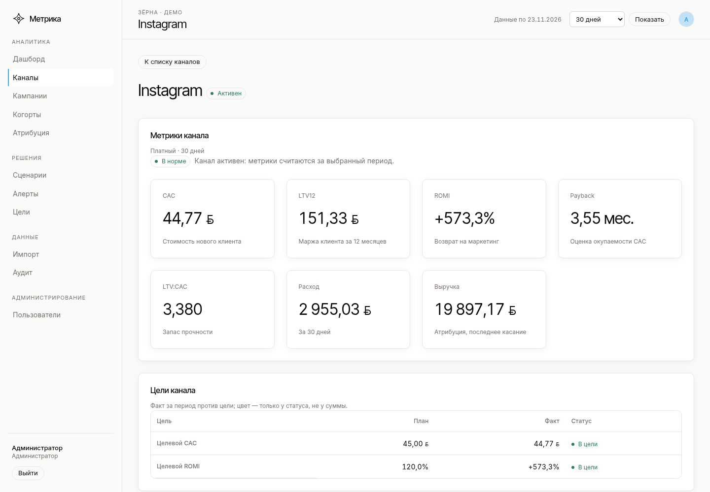

**Что здесь можно понять.** Один канал крупным планом: CAC, LTV12, ROMI, payback, LTV:CAC, расход и выручка.
Рядом — цели канала (план/факт/статус), недельные ряды CAC и ROMI, воронка, удержание и кампании канала. Это
удобно для разговора о конкретном канале: видно не только «дорого/дёшево», но и на каком участке воронки
теряются люди.

**Что можно сделать.** Вернуться к списку, сменить период, открыть кампанию канала. Наблюдатель видит те же
данные; менять настройки канала нужно в списке каналов.

**Что важно.** Паспорт показывает только канал из адреса. Если в адресе чужой или несуществующий id, вы получите
`404`; если прав на раздел нет — `403`.

### 3.4. Кампании

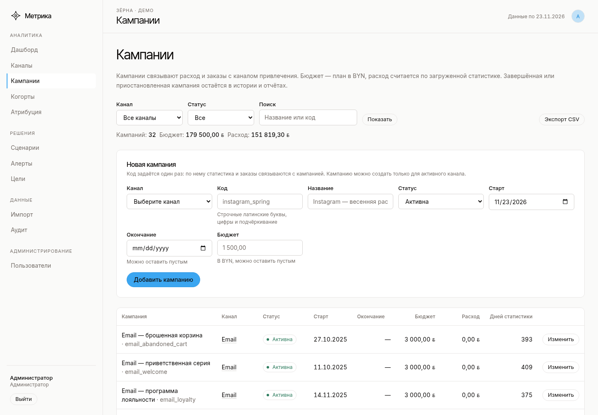

**Что здесь можно понять.** Кампании связывают расход и заказы с каналом. Сверху — число кампаний, суммарный
бюджет и фактический расход по выбранным фильтрам. В таблице — канал, статус, даты, бюджет, расход и число дней
статистики.

**Что можно сделать.** Фильтровать по каналу, статусу и поисковой строке; экспортировать CSV. Аналитик и
администратор создают кампанию, меняют её и удаляют. Кампанию можно создать только для активного канала.

**Что важно.** Бюджет — это план в BYN, а расход считается по загруженной статистике, поэтому они не обязаны
совпадать. Код кампании задаётся один раз. Кампанию с данными удалить нельзя: она остаётся в истории и отчётах;
завершённая или приостановленная кампания тоже не исчезает.

### 3.5. Когорты

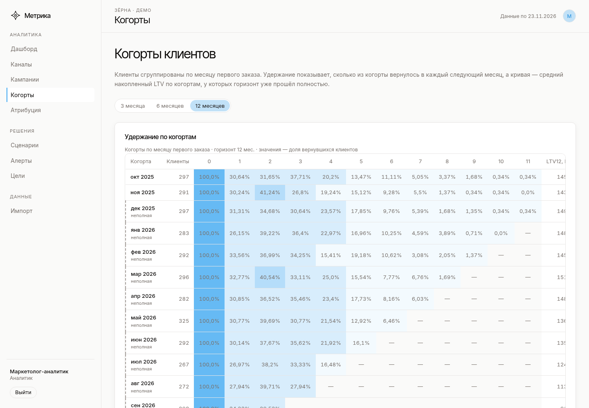

**Что здесь можно понять.** Клиенты сгруппированы по месяцу первого заказа. Строка — когорта, столбцы — месяцы
жизни; значения показывают долю вернувшихся. Кривая ниже — средний накопленный LTV по когортам, у которых
горизонт уже прошёл полностью (3, 6 или 12 месяцев).

**Что можно сделать.** Переключить горизонт 3/6/12 месяцев и раскрыть таблицу. Экран только для чтения.

**Что важно.** Пунктир и подпись «неполная» означают, что у когорты ещё не прошёл весь горизонт. Пустая ячейка
`—` — это «месяц ещё не наступил», а не нулевое удержание. В средний LTV попадают только завершённые когорты,
поэтому кривая не завышается свежими клиентами.

### 3.6. Атрибуция

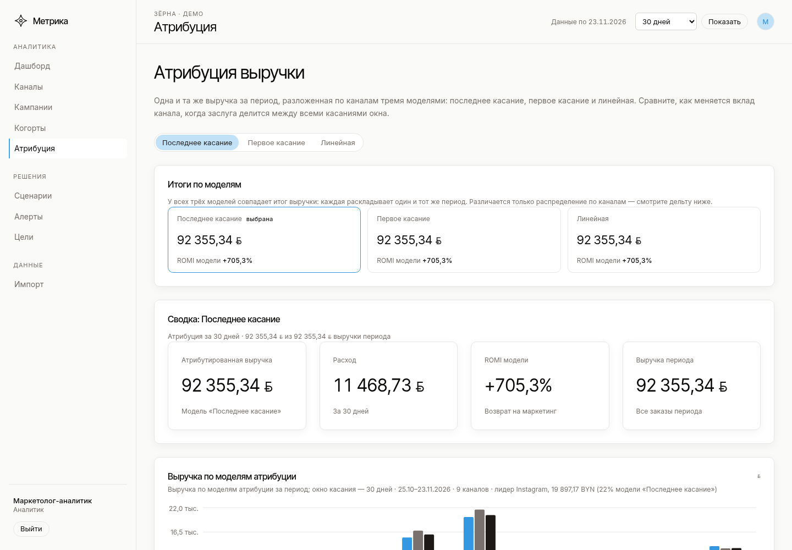

**Что здесь можно понять.** Одна и та же выручка периода раскладывается по каналам тремя моделями: последнее
касание, первое касание и линейная. Итог выручки у всех трёх одинаков — различается только распределение заслуги.
Таблица и дельта показывают, какой канал выигрывает или проигрывает при смене модели.

**Что можно сделать.** Выбрать модель, период и раскрыть таблицу. Экран только для чтения: атрибуция не меняет
заказы и не пересчитывает историю.

**Что важно.** Окно касаний — 30 дней. Если у заказа не было касания в окне, используется канал первого
привлечения клиента; если неизвестен и он, заказ не приписывается. Сумма по каналам может быть меньше выручки
периода — это ограничение модели, а не ошибка страницы.

### 3.7. Алерты

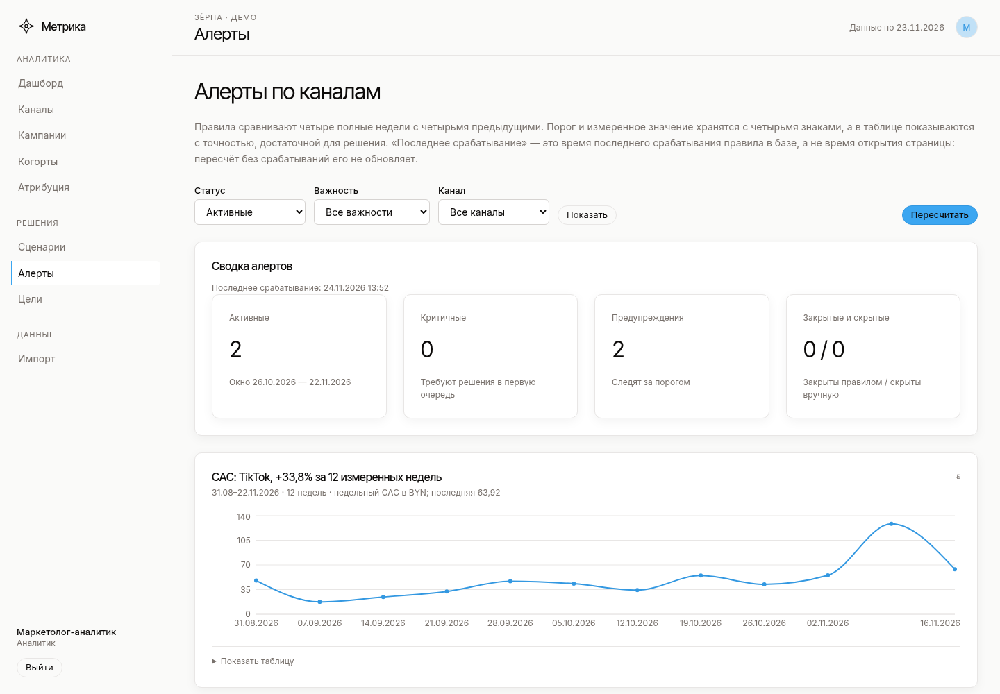

**Что здесь можно понять.** Правила сравнивают четыре полные недели с четырьмя предыдущими. В сводке — активные
алерты, критичные и предупреждения, закрытые и скрытые. В таблице — канал, правило, важность, измеренное значение,
порог, период и время срабатывания. «Последнее срабатывание» — время последнего срабатывания правила в базе, а не
время открытия страницы.

**Что можно сделать.** Фильтровать по статусу, важности и каналу, пересчитать правила. Аналитик и администратор
могут скрыть алерт, указав причину до 200 символов; причина и действие попадают в аудит. Наблюдатель только
читает.

**Что важно.** Повторный пересчёт не плодит дубли: строка уникальна по каналу, правилу и началу периода. Скрытый
вручную алерт остаётся `dismissed`; `resolved` снова открывается, если правило сработало в новом окне. У аналитика
автоматический пересчёт — не чаще одного раза в час на сессию; кнопка «Пересчитать» работает всегда.

### 3.8. Сценарии бюджета

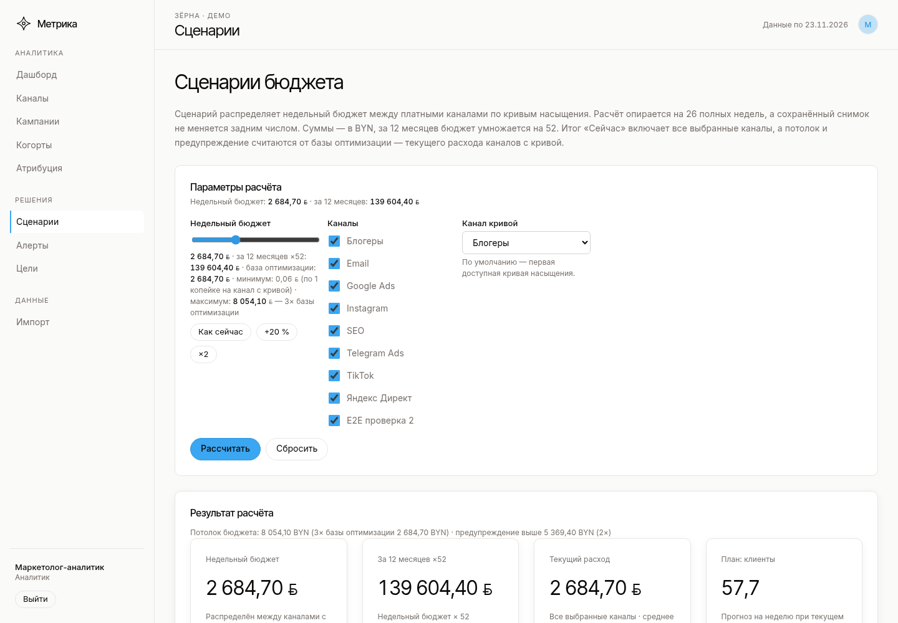

**Что здесь можно понять.** Сценарий распределяет недельный бюджет между платными каналами по кривым насыщения.
Рядом — «сейчас» и «план»: CAC, ROMI, клиенты и расход. Прогноз подписан как недельный и годовой (×52), чтобы
недельные цифры не принимали за годовые.

**Что можно сделать.** Двигать слайдер, выбирать пресеты «Как сейчас», «+20 %», «×2», отмечать каналы и нажать
«Рассчитать». Аналитик и администратор сохраняют сценарий; снимок открывается по ссылке и не пересчитывается
задним числом. Ссылка «Повторить» возвращает параметры в builder. Наблюдатель видит сохранённые сценарии.

**Что важно.** Верхняя граница — 3× текущего недельного расхода; выше 2× появляется предупреждение об
экстраполяции. Каналы без валидной кривой (`linear` или `no_data`) остаются в таблице, но не участвуют в
распределении. Линейная кривая помечена «линейная кривая — без оптимума»: это не ошибка, а честное ограничение
модели.

### 3.9. Цели

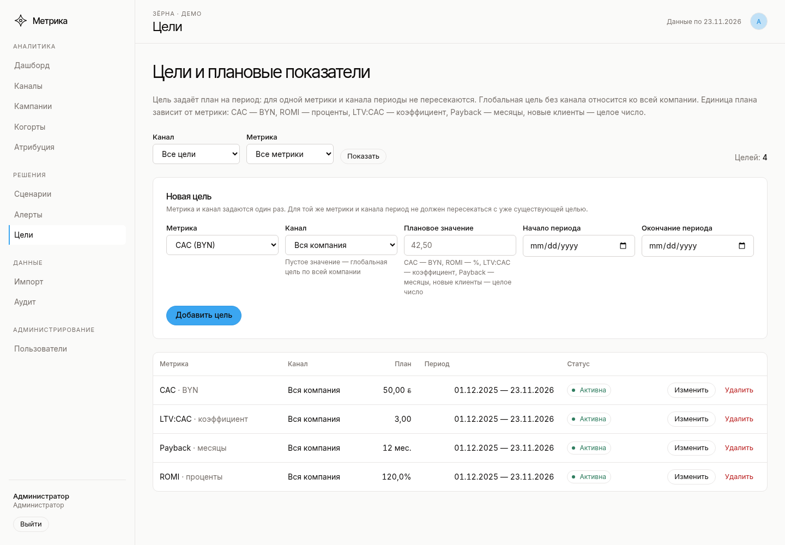

**Что здесь можно понять.** Цель задаёт план на период для одной метрики и канала. Глобальная цель без канала
относится ко всей компании. Единицы зависят от метрики: CAC — BYN, ROMI — проценты, LTV:CAC — коэффициент,
payback — месяцы, новые клиенты — целое число. Статус показывает, активна ли цель.

**Что можно сделать.** Фильтровать по каналу и метрике; аналитик и администратор создают, меняют и удаляют цели.
Метрика и канал после создания не меняются — проще создать новую цель.

**Что важно.** Для одной метрики и канала периоды не должны пересекаться: иначе план невозможно однозначно
сравнить с фактом. Плановые значения видны на паспорте канала и в целях; факт считается за период, а не за всё
время.

### 3.10. Импорт CSV

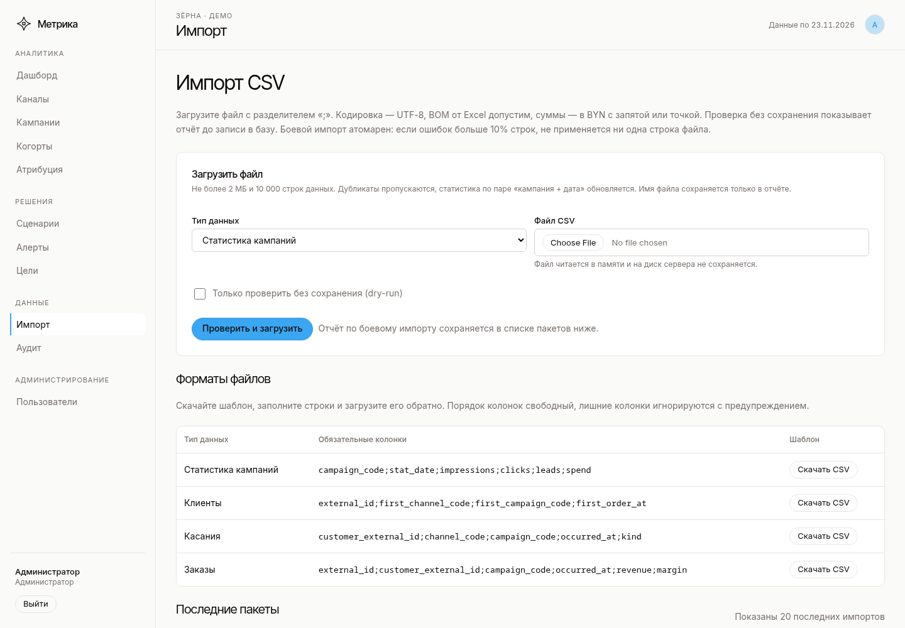

**Что здесь можно понять.** Поддерживаются четыре типа данных: статистика кампаний, клиенты, касания и заказы.
Для каждого есть обязательные колонки и кнопка «Скачать CSV» с шаблоном. Внизу — последние пакеты импорта с
числом строк и ошибками.

**Что можно сделать.** Выбрать тип, приложить `.csv`, включить «Только проверить без сохранения (dry-run)» и
нажать «Проверить и загрузить». Dry-run показывает отчёт до записи; боевой импорт сохраняет строки и создаёт
пакет. Аналитик и администратор могут импортировать, наблюдатель — нет.

**Что важно.**

- Разделитель — `;`, кодировка UTF-8, BOM от Excel допустим. Суммы — в BYN с запятой или точкой.
- Лимиты: не больше 2 МБ и 10 000 строк данных. Файл читается в памяти и на диск сервера не сохраняется.
- Дубликаты пропускаются; статистика по паре «кампания + дата» обновляется.
- Боевой импорт атомарен: если ошибок больше 10% строк, не применяется ни одна строка файла.
- Принимается только `.csv` с CSV-типом; PNG и другие типы отклоняются до разбора.

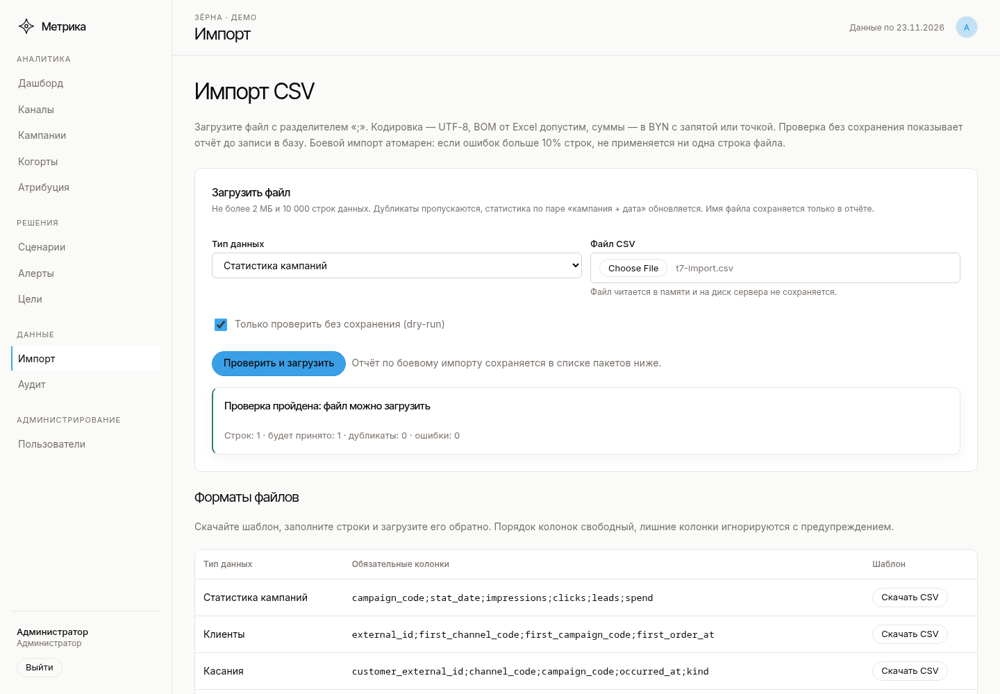

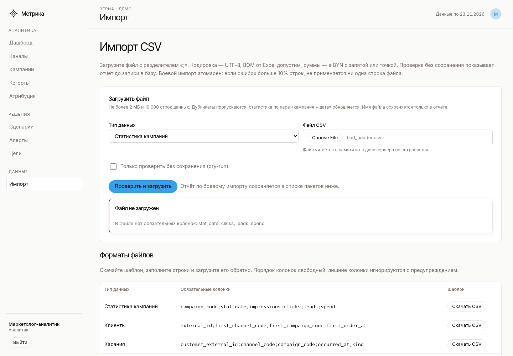

### 3.11. Экспорт CSV

Отдельного экрана экспорта нет: кнопка «Экспорт CSV» стоит на экранах каналов и кампаний и учитывает текущие
фильтры. Прямые ссылки для статистики и заказов — `/app/export/daily_stats.csv` и `/app/export/orders.csv`.

**Что можно понять и сделать.** Файл открывается в Excel и содержит BOM, чтобы кириллица не превратилась в
кракозябры. Формулы экранируются от formula injection, а сам факт экспорта записывается в аудит. Экспорт доступен
всем трём ролям: это чтение, а не изменение данных.

### 3.12. Аудит

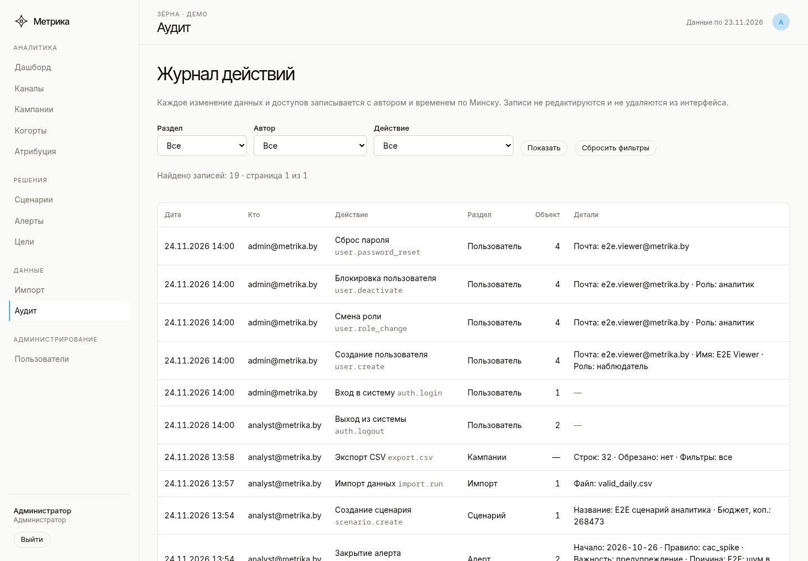

**Что здесь можно понять.** Кто, когда и что изменил: вход и выход, создание и правка каналов, кампаний, целей,
импорт, экспорт, сценарии, алерты, пользователи. Время — по Минску. Записи не редактируются и не удаляются из
интерфейса.

**Что можно сделать.** Фильтровать по разделу, автору и действию, сбросить фильтры. Раздел доступен только
администратору; остальным — `403`.

**Что важно.** Аудит — журнал фактов, а не лента уведомлений. Если действие не попало в журнал, это дефект
продукта; сообщите администратору стенда.

### 3.13. Пользователи

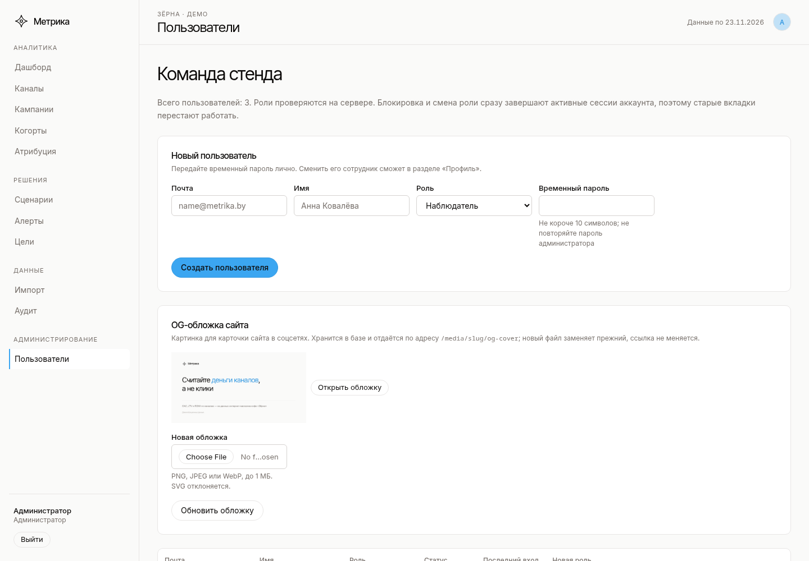

**Что здесь можно понять.** Список аккаунтов, роли, статус, последний вход. Роли проверяются на сервере; смена
роли и блокировка сразу завершают активные сессии.

**Что можно сделать.** Создать пользователя с временным паролем, сменить роль, заблокировать/разблокировать,
сбросить пароль. Здесь же администратор загружает OG-обложку сайта: PNG, JPEG или WebP до 1 МБ; SVG отклоняется,
потому что внутри может быть скрипт.

**Что важно.** Временный пароль передаётся лично, а не в общий чат. Сброс пароля не показывает старый пароль:
он задаёт новый временный. Экран доступен только администратору.

### 3.14. Профиль

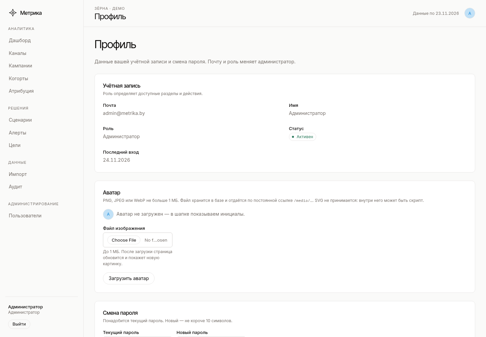

**Что здесь можно понять.** Свои email, имя, роль, статус и дату последнего входа. Почту и роль меняет
администратор, не пользователь.

**Что можно сделать.** Загрузить аватар (PNG, JPEG или WebP до 1 МБ) и сменить пароль. Новый пароль — не короче
10 символов; нужен текущий пароль.

**Что важно.** Аватар хранится в PostgreSQL и отдаётся по `/media/…`; если он не загружен, в шапке показываются
инициалы. SVG не принимается.

### 3.15. Лендинг и мобильная версия

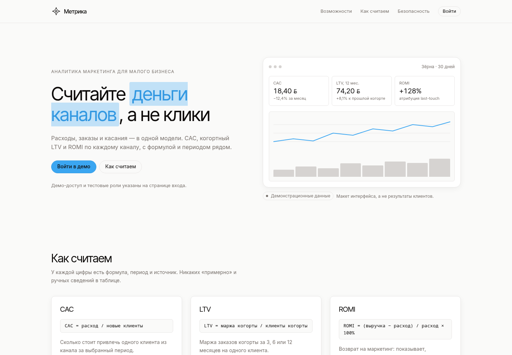

Лендинг `/` — публичная страница без входа. На ней нет живых данных компании: пример дашборда помечен как
демонстрационный. Ссылка «Войти в демо» ведёт на `/login`. Демо-логины перечислены в этом руководстве и README;
на самой форме входа список аккаунтов не выводится.

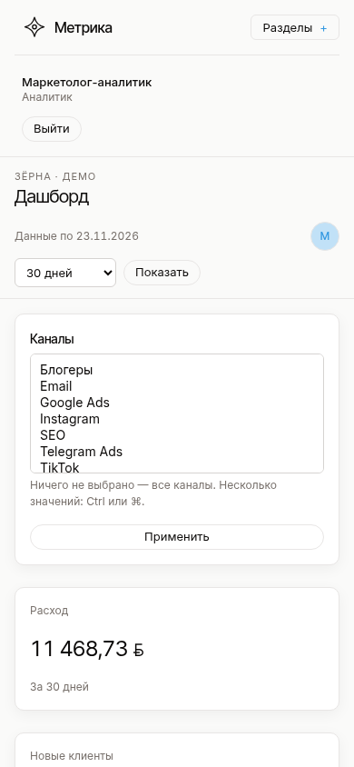

На 390×844 интерфейс не прокручивается горизонтально: таблицы скроллятся внутри своих контейнеров, меню
раскрывается кнопкой «Разделы», порядок Tab начинается с «Перейти к содержанию». Клавиатурный обход проверен на
всех основных экранах.

## 4. Ошибки и что делать

| Что видите | Причина | Действие |
|---|---|---|
| Стилизованная страница `403` «Недостаточно прав» | у роли нет права на раздел или действие | войти под другой ролью; скрытие кнопки не отменяет серверную проверку |
| Стилизованная страница `404` «Страница не найдена» | опечатка в адресе или удалённый объект | вернуться на дашборд или к списку; проверить id в ссылке |
| Стилизованная страница `500` «Что-то сломалось» | отказ БД или ошибка сервера | обновить страницу браузером; если повторяется — сообщить администратору и время ошибки |
| После входа снова форма входа | сессия истекла (8 часов) или аккаунт заблокирован | войти заново; уточнить статус у администратора |
| Вход отвечает `429` | сработал лимит попыток | подождать 15 минут; не подбирать пароль вручную |
| Импорт: `413` «Файл превышает допустимый размер 2 МБ» | файл больше лимита | разбить файл или уменьшить его; лимит не поднимать без пересмотра безопасности |
| Импорт: `400` «Превышен лимит 10 000 строк» | слишком много строк данных | разбить на несколько файлов |
| Импорт: «В файле нет обязательных колонок…» | неверный заголовок или разделитель | скачать шаблон, сверить колонки и `;` |
| Импорт: «Допустим только файл CSV с расширением .csv» | загружен не CSV | сохранить как `.csv` в UTF-8 |
| Импорт: много ошибок, ничего не сохранено | ошибок больше 10% строк | исправить строки по отчёту и повторить; частичного импорта нет |
| `/health` отвечает `503` | PostgreSQL недоступен | это работа стенда, а не браузера: сообщить администратору; после восстановления БД health вернётся в `200` |
| Аватар или обложка не загружаются | не PNG/JPEG/WebP, больше 1 МБ или SVG | привести файл к допустимому типу и размеру |

Технические команды, резервное копирование и развёртывание описаны в
[руководстве по развёртыванию](deployment.md). Пользователю они не нужны.

## 5. Резервное копирование: для оператора

В интерфейсе нет кнопки «Сделать бэкап»: копии создаёт оператор стенда, у которого есть доступ к серверу и `.env`.
Обычному пользователю этот раздел нужен только чтобы понимать, почему администратор иногда просит не работать в
системе во время восстановления.

- Копия — `pg_dump` в custom-формате, зашифрованный AES-256-GCM. Ключ лежит отдельно, в файле с правами `0600`
  (Windows — ACL); без ключа копию не расшифровать.
- `npm run backup` создаёт `metrika-YYYY-MM-DDTHH-mm-ssZ.dump.enc`; retention удаляет только старые
  `metrika-*.dump.enc`, минимум одна копия остаётся.
- Проверка копии — восстановление в отдельную scratch-базу с `--verify`: сравниваются row-count и key checksum по
  ключевым таблицам. «Файл создан» без восстановления не считается проверенной копией.
- Восстановление поверх рабочей БД требует `--force` и остановки приложения. Это разрушительная операция: сначала
  снимается аварийная копия, потом восстанавливается выбранный файл.
- На Windows копию запускает Планировщик заданий; на Linux — cron/systemd. Команды, ACL и расписание — в
  [руководстве по развёртыванию](deployment.md), разделы «Windows 10» и «Резервное копирование и восстановление».

Если восстановление идёт на рабочий стенд, пользователи увидят вход заново: сессии тоже входят в дамп. Это
нормально; предупредите их до начала работ.

## 6. Демо-данные и границы

Все цифры стенда — вымышленные. Они не являются результатами реальных клиентов и не годятся для бизнес-решений.
Совпадения с реальными организациями случайны. Демо-пароль опубликован намеренно; перед публичным запуском
смените пароли, `SESSION_SECRET`, включите HTTPS и `COOKIE_SECURE=true`.

Стенд не заменяет бухгалтерию и рекламные кабинеты: он показывает расчёт по загруженным CSV и честно помечает
неполные данные. Если цифра вызывает сомнение, откройте таблицу-дубль под графиком и проверьте период, единицы и
data anchor — чаще всего вопрос решается там.
